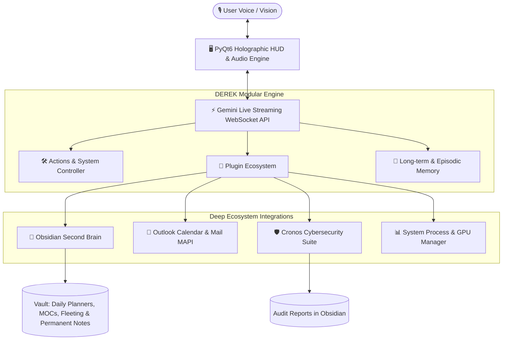

# ⚡ D.E.R.E.K.
### Autonomous Multimodal AI Desktop Assistant & Second Brain Operating System

[](https://www.python.org/)
[](https://ai.google.dev/)
[](https://www.riverbankcomputing.com/software/pyqt/)
[](https://obsidian.md/)
[](LICENSE)

**DEREK** (*Dynamic Executive Reasoning & Execution Kernel*) is an advanced, privacy-conscious personal AI operating assistant designed for Windows, macOS, and Linux. Built upon the high-speed **Google Gemini Live API (Audio/Vision WebSocket)** and extended with enterprise knowledge management, **DEREK** transforms your desktop into an autonomous operations center that can hear, see, speak, manage your **Obsidian Second Brain**, synchronize your **Outlook Calendar**, and perform **ethical cybersecurity audits**.

---

## 🌟 Key Highlights & Architecture



---

## 🚀 Distinctive Capabilities

### 1. 🧠 Obsidian "Second Brain" Deep Integration
* **Instant Voice-to-Vault:** Capture thoughts, create fleeting notes, and structure permanent notes on the fly using native Windows URI protocol without command line truncations.
* **Daily Planner & Task Automation:** Injects and checks tasks (`- [ ]`) directly into your daily planner (`05-Planners/Daily/YYYY-MM-DD.md`).
* **Accent-Tolerant Search:** Full-text search across thousands of markdown notes, treatises, and academic archives.

### 2. 📅 Microsoft Outlook Calendar & Email Bridge
* **MAPI Real-time Queries:** Ask *"Derek, what meetings do I have today?"* or *"When is my next appointment?"* with instant low-latency voice responses.
* **Calendar-to-Vault Sync:** Automatically exports today's scheduled events into your Obsidian daily journal.

### 3. 🛡️ Cronos Ethical Hacking & Cybersecurity Auditor
* **Autonomous Reconnaissance:** Performs authorized port scanning, SSL/TLS certificate verification, and HTTP security header analysis.
* **Automated Audit Logging:** Compiles formatted executive markdown reports directly into `06-Projects/HCK Etico/`.

### 4. 🧑‍🎤 3D Holographic HUD & Real-time Lip-Sync
* **Software-Rendered Facial Geometry:** Zero heavy 3D engine overhead. Facial movements, blinks, and gaze shifts driven by acoustic formants and transcript phonemes (~50 FPS).
* **GPU Throttling (Optimized for Efficiency):** Intelligent 15 FPS idle rate preventing unnecessary 100% GPU spikes while maintaining fluid responsiveness.
* **Self-Echo & Tail Guard:** Recognizes the tail of its own voice to prevent the assistant from interrupting itself or answering its own output.

### 5. 🧩 Zero-Boilerplate Plugin System
* Self-describing plugins located in `plugins/`. Any Python file defining a `PLUGIN` dictionary and a `run()` handler is automatically registered and provided to Gemini's tool-calling engine at boot time.

---

## 📦 Project Structure

```text
Derek/
├── actions/                  # Core computer control tools (files, apps, screen, web search)
├── config/
│   ├── api_keys.example.json # Safe configuration template (API keys & customization)
│   ├── jarvis.ico            # Application icon
│   └── prompt.txt            # Custom operational system prompt
├── core/                     # Audio drivers, avatar rendering, wake word, Gemini client
├── dashboard/                # Optional encrypted web remote control interface
├── memory/                   # Config and memory manager
├── plugins/                  # Specialized modular plugins
│   ├── obsidian_vault.py     # Native Obsidian URI vault controller
│   ├── second_brain.py       # Knowledge retrieval and planner parser
│   ├── outlook_controller.py # Microsoft Outlook MAPI bridge
│   ├── cronos_pentest.py     # Network and web cybersecurity auditing
│   ├── process_manager.py    # Hardware performance & CPU/RAM monitor
│   └── _template.py          # Developer blueprint for new plugins
├── derek.vbs                 # Silent background Windows launcher
├── main.py                   # Application entry point & Live API orchestration
├── requirements.txt          # Python dependencies
└── ui.py                     # PyQt6 HUD interface & animation canvas
```

---

## 🛠️ Quick Start Guide

### Prerequisites
* **Python 3.10+** (Tested up to Python 3.14 on Windows 11).
* A free or paid **Google Gemini API Key** ([Google AI Studio](https://aistudio.google.com/)).
* (Optional) **Obsidian** installed locally with your personal vault.
* (Optional) **Microsoft Outlook** desktop client.

### 1. Clone the Repository
```bash
git clone https://github.com/CyberPater-Dev/Derek.git
cd Derek
```

### 2. Install Dependencies
```bash
pip install -r requirements.txt
```

### 3. Configure Your Environment
Copy the example configuration file:
```bash
cp config/api_keys.example.json config/api_keys.json
```
Edit `config/api_keys.json` with your preferred settings:
```json
{
  "gemini_api_key": "YOUR_GEMINI_API_KEY_HERE",
  "os_system": "windows",
  "hud_style": "core",
  "assistant_name": "DEREK",
  "user_name": "Your Name",
  "ui_color": "#00d4ff"
}
```

*(Optional)* If using Obsidian, set your vault path via environment variable or in your profile:
```powershell
[System.Environment]::SetEnvironmentVariable('OBSIDIAN_VAULT_PATH', 'C:\Path\To\Your\Vault', 'User')
```

### 4. Run DEREK
```bash
python main.py
```
Or double-click `derek.vbs` on Windows to launch silently in the background.

---

## ⌨️ Controls & Shortcuts

| Shortcut / Button | Action |
|---|---|
| **F4** | Toggle Microphone Mute / Active |
| **F11** | Toggle Fullscreen Mode |
| **Ctrl + Space** | Global Push-to-Talk (Hold to speak, release to send) |
| **Esc** | Interrupt Assistant Response |

---

## 🧩 Developing Custom Plugins

Creating a plugin takes less than 30 seconds. Create `plugins/my_tool.py`:

```python
PLUGIN = {
    "name": "my_custom_tool",
    "description": "Explains to the AI when and how to call this tool.",
    "parameters": {
        "type": "OBJECT",
        "properties": {
            "query": {"type": "STRING", "description": "Input parameter description"}
        },
        "required": ["query"]
    }
}

def run(parameters: dict, player=None, session_memory=None) -> str:
    query = parameters.get("query", "")
    # Your custom automation logic here
    return f"Processed: {query}"
```
Restart DEREK, and the tool is immediately active and known to the AI.

---

## 🔒 Security & Privacy Notice
* **Local First:** All vault notes, personal logs, and memories reside strictly on your local disk.
* **No Telemetry:** DEREK communicates only with the official Google Gemini API endpoint specified in your configuration.
* **Sensitive Exclusions:** `config/api_keys.json`, OAuth tokens, session databases, and `.env` files are permanently excluded in `.gitignore`.

---

## 📜 License & Acknowledgments
* Licensed under the **Creative Commons Attribution-NonCommercial 4.0 International (CC BY-NC 4.0)**.
* Core architecture inspired by the open-source **Mark-LV** framework by *FatihMakes*.
* Extended and maintained with specialized integrations for PKM, Obsidian, and autonomous computing.
